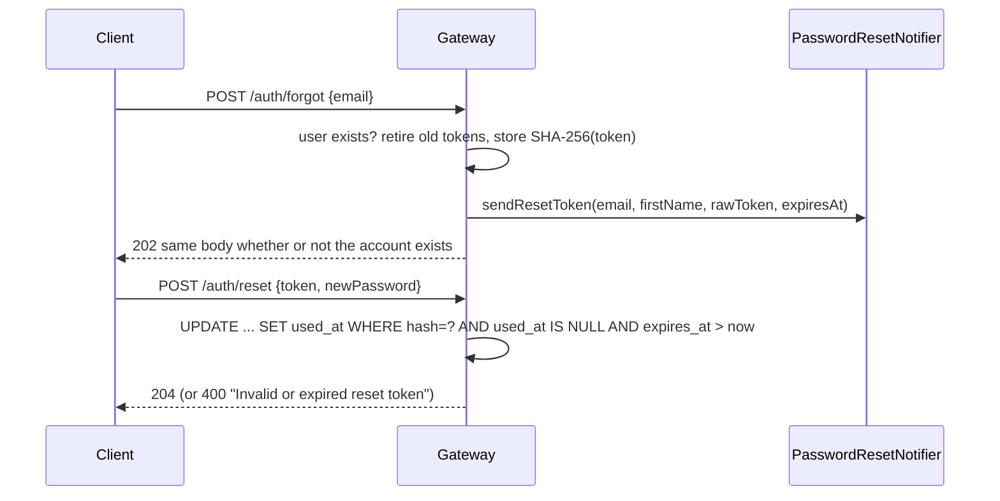

# Password reset

`POST /auth/forgot` issues a single-use, expiring token; `POST /auth/reset` redeems it and sets a new
password. Both live in the gateway next to login and registration, are public (`/auth/**` is
`permitAll`) and share the existing `/auth` IP rate limit (`AuthRateLimitFilter`), so no new limiter
was added.

## Flow

## Decisions

- **No user enumeration.** `/auth/forgot` returns the same `202` and body for known and unknown
  addresses, and a notifier failure is logged and swallowed rather than surfaced, because an error only
  on the known-account path would reveal it. Response time is not equalised: the known-account path does
  a few database writes the unknown one skips. A real notifier should hand off to a queue so the send
  itself adds nothing measurable.
- **Token storage.** 32 random bytes (`SecureRandom`), base64url. Only the SHA-256 hash is stored
  (`password_reset_token.token_hash`), so reading the table does not yield usable links. The raw token
  exists only in the notifier call.
- **Single use under concurrency.** Redemption is one conditional `UPDATE` (the repository's
  `markUsedIfValid`), the same compare-and-set idea as `RefreshTokenRepository.markUsedIfTokenNotYetUsed`.
  Two simultaneous resets with one token cannot both succeed.
- **One live token per user.** Asking again, or completing a reset, retires every other unused token of
  that user.
- **One failure message.** Unknown, expired and used tokens are all `400 Invalid or expired reset token`.
- **Sessions.** A successful reset revokes all of the user's refresh tokens. An access token already
  issued stays valid until its own expiry; the gateway keeps no access-token denylist.
- **Password rule.** The same as registration (non-blank). Tightening it would be a separate change for
  both endpoints.

## Email delivery is a port

`PasswordResetNotifier` is the seam. The shipped `LoggingPasswordResetNotifier` sends nothing; with
`app.password-reset.log-token=true` (`PASSWORD_RESET_LOG_TOKEN`) it logs the raw token so the flow can be
tried locally. That flag is development only: a logged token is a working takeover link. Any other
`PasswordResetNotifier` bean replaces the default (`@ConditionalOnMissingBean` in
`PasswordResetConfig`).

## Configuration

| Property | Env | Default |
|---|---|---|
| `app.password-reset.token-ttl` | `PASSWORD_RESET_TOKEN_TTL` | `30m` |
| `app.password-reset.log-token` | `PASSWORD_RESET_LOG_TOKEN` | `false` |

## Schema

`V4__create_password_reset_token.sql` (gateway). `V3` is the email-normalisation migration from the
duplicate-registration change, so this work is stacked on it. The FK to `user_entity` cascades, so
deleting a user removes their tokens.

## Tests

`PasswordResetServiceTest` (hashing, retirement, swallowed notifier failure, reject paths),
`PasswordResetTokenRepositoryTest` (the conditional updates against a real JPA slice),
`AuthControllerTest` (status codes, body validation, email normalisation), and
`AuthRateLimitFilterTest` (both paths are limited). H2 cannot run the migration; it was applied to a
Postgres 15 container by hand.
