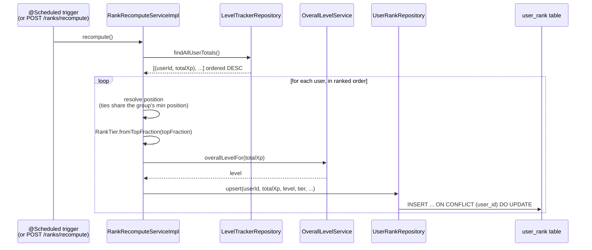
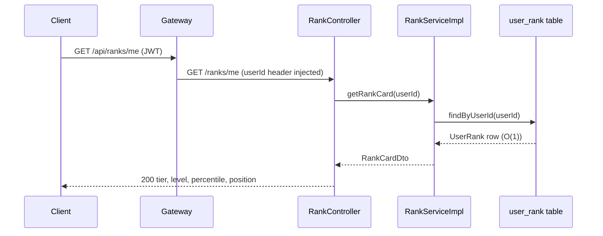

# Overall Level, Percentile Ranks & Within-Tier Leaderboards

**Service:** `gamification-service` · **Key classes:** `RankTier`, `RankRecomputeServiceImpl`,
`UserRank`, `RankService`, `RankController`

## What it is / why it's notable

Every user has an **overall level** (absolute, derived from lifetime XP against a seeded threshold
curve) and a **rank** (relative, their percentile standing among *all* tracked users, expressed as one
of nine Summit-themed tiers, each in three divisions, computed from recent form). The two are deliberately different kinds of progression: level only ever
goes up; rank is a live standing that can **promote or demote** a user as other people earn XP — the
same dynamic that makes Clash-of-Clans-style leagues compelling. Sitting on top of both is a
**within-tier leaderboard**, so every tier has its own race instead of everyone chasing one unreachable
global #1.

The interesting engineering is in how cheaply this stays correct at read time: ranking is an O(N log N)
sweep over every user, which is too expensive to do per request. Instead a scheduled batch
(`RankRecomputeServiceImpl`) sorts everyone once, resolves each person's tier from a single
authoritative percentile→tier table (`RankTier`), and writes the result into a **materialized snapshot**
(`UserRank`) that every read endpoint serves directly — O(1) for a personal card, O(page) for a
leaderboard.

That O(page) claim depends on `idx_user_rank_tier_total_xp` (`V6__create_gamification_indexes.sql`,
issue #85) — `user_rank` originally carried only its `user_id` primary key, so
`findByTierOrderByTotalXpDesc` (the tier leaderboard) and `countByTier` both scanned the whole table.
`countByTier` is the sharper case: `RankServiceImpl.getDistribution` calls it once **per tier** —
nine tiers, nine full scans — on every single `GET /ranks` request before this index existed.

## How it works





Every read (`/me`, `/{tier}/leaderboard`, `/me/leaderboard`, the distribution) hits the snapshot table
only — no cross-user aggregation happens on the request path. The batch is the only place that does the
expensive O(N) work.

### The rank nudge on `GET /ranks/me`

The card also carries `tierCutoffXp`, `nextTier` and `xpToNextTier`, so a result screen can say "1,500
XP to PEAK". They come from one grouped query over the snapshot (`findTierFloors`: the lowest XP in
every *populated* tier) rather than from the tier definitions, because tiers are assigned by relative
position, not by XP thresholds: there is no fixed "XP you need for PEAK". The honest answer is "match the
weakest member of the next tier up", which is what `xpToNextTier` reports.

Two consequences worth knowing. An **empty tier is skipped**: nobody occupies it, so no amount of XP
reaches it, and the next *populated* better tier is reported instead. And the numbers **move** — every
boundary shifts as other users earn XP — so they are only as fresh as the last recompute and should be
presented as a nudge, not a promise. `percentile` is untouched (a top fraction; `0` is best).

An unranked caller still gets `404` by default; `?allowUnranked=true` opts in to `200 {"ranked": false}`,
so the default can be flipped once the frontend no longer treats the `404` specially.

### Fluid ranks: recent form, divisions, movement (issue #135)

A rank used to be a percentile of **lifetime** XP, recomputed every 5 minutes into nine fixed bands. That is
stiff: early players entrench, a player who stops logging never drops, nothing happens between tier lines,
nobody can see whether they moved, and a session takes minutes to show. Four changes, all on the rank side;
the lifetime figures (`totalXp`, `overallLevel`, `GET /leaderboard`) are unchanged.

**1. The order is recent form, not lifetime XP.** Each award counts for `xp * 0.5^(age / halfLife)` with a
14-day half-life (`ranking.half-life-days`): an award a fortnight old is worth half, a month old a quarter.
`RankScore` holds that maths as pure functions. The inputs are the two tables that already timestamp every
award: `log_xp_outcome` (one row per applied log) and `manual_xp_award` (admin awards count for their target
user). Rows older than eight half-lives are never read (under 0.4% of their value), and an index on
`log_xp_outcome.occurred_at` keeps that read to the recent slice.

The age is **when the session happened**, not when it was processed. `ActivityLoggedEvent` carries an
optional `occurredAtEpochMilli` (the log end time, UTC), the consumer stores it as
`log_xp_outcome.occurred_at`, and a backdated or late-approved log therefore counts from its session time.
The field is nullable and absent JSON reads as null, so in-flight messages and unpublished outbox rows stay
valid; a null falls back to the time the XP was applied, and a time in the future is clamped to now.

Ties on the score are broken by lifetime XP, so a crowd of lapsed users (all near zero) still sorts
sensibly instead of landing in one band. Only users equal on **both** keys share a position. XP applied
before `log_xp_outcome` existed (V7) has no session time and does not count toward the score.

**2. Divisions.** Each tier band is cut into three equal thirds, `1` (best) to `3`, by
`RankTier.divisionFor(topFraction)`; `divisionProgress` says how far up the current division the user sits
(0 about to drop, 1 about to be promoted). The nudge now has two levels: `nextTier` / `xpToNextTier` as
before, and `nextDivisionTier` / `nextDivision` / `xpToNextDivision` for the next better *populated*
division, which from division 1 is the lowest division of the tier above. Both are "match the weakest
member of that step", measured in score; XP earned now adds to the score one for one.

**3. Movement.** `user_rank` keeps a baseline (`previous_tier`, `previous_division`, `previous_position`,
`previous_at`). The recompute carries it forward while it is younger than `ranking.movement-window-hours`
(24) and then rolls it to the state the row had just before the update, so the card reports change over
roughly the last day, not since the previous 30 seconds (which would almost always read zero). It exposes
`positionChange` (positive is up), `previousTier`, `previousDivision` and a `trend`: `NEW` (no baseline
yet), `PROMOTED` / `DEMOTED` (tier or division changed), or `UP` / `DOWN` / `SAME` (same step, position
moved). `RankMovement` holds the comparison. The baseline resets abruptly when it rolls, so a client should
treat the trend as "recent movement", not a precise delta.

**4. Faster.** `ranking.recompute-interval-ms` went from 300000 to 30000, with `lock-at-most-for` moved
below it (`PT25S`) so the ShedLock never outlives the interval. Decay changes every score continuously, so a
periodic recompute is the right model, and one pass over the users plus the recent award rows is cheap at
this scale; at much larger scale this is the knob to revisit.

`tier`, `percentile`, `position`, `tierCutoffXp` and `xpToNextTier` now follow the score, which is a
behaviour change for anything that read them as lifetime standings. The tier boards order by
`rank_score`; `GET /ranks/me` still 404s until ranked and `percentile` is still a top fraction.

## Key classes & code

**`RankTier`** (`gamification-service/.../dao/RankTier.java`) is the single authoritative percentile→tier mapping. Each of the 9 tiers carries its `[lo, hi)` band;
`fromTopFraction` scans from the top tier down and returns the first one whose `lo` the fraction clears —
so every tier's upper edge is implicit (the next tier's `lo`), and there's no separate boundary to keep
in sync:

```java
public static RankTier fromTopFraction(double topFraction) {
    RankTier[] tiers = values();
    for (int i = tiers.length - 1; i >= 0; i--) {
        if (topFraction >= tiers[i].lo) {
            return tiers[i];
        }
    }
    return SUMMIT;
}
```

| Bracket | topFraction | Tier |
|---|---|---|
| top 5% | `[0.00, 0.05)` | SUMMIT |
| 5–15% | `[0.05, 0.15)` | PEAK |
| 15–25% | `[0.15, 0.25)` | RIDGE |
| 25–50% | `[0.25, 0.50)` | ALPINE |
| 50–60% | `[0.50, 0.60)` | ASCENT |
| 60–75% | `[0.60, 0.75)` | HIGHLAND |
| 75–85% | `[0.75, 0.85)` | FOOTHILL |
| 85–95% | `[0.85, 0.95)` | TRAILHEAD |
| 95–100% | `[0.95, 1.00]` | BASECAMP |

**`RankRecomputeServiceImpl.recompute()`** — the batch. `LevelTrackerRepository.findAllUserTotals()`
returns every user lifetime XP total; since issue #135 the order is the recency-weighted score (lifetime XP breaks ties) and the method walks that list
once, assigning a 1-based position and computing `topFraction = (position-1)/totalUsers`. **Tied users
share the tie group's minimum position** — two people tied at the top both land on position 1, and the
next distinct value picks up from the raw sequential count rather than the tie-inflated one — so equal
XP never splits arbitrarily across a tier boundary. `OverallLevelService.overallLevelFor` resolves the
absolute level the same way `ActivityLevelThresholdRepository` already resolves per-activity levels:
highest seeded threshold cleared, ordered `DESC`, capped to one row via `Pageable`.

**`UserRankRepository.upsert`** — a native `INSERT ... ON CONFLICT (user_id) DO UPDATE SET ...`, the
same idempotent-upsert idiom as `LevelTracker.insertIfAbsent` and
`UserAchievementRepository.grantIfAbsent`, except it *updates* on conflict rather than no-op'ing — a
recompute should overwrite a stale snapshot, not skip it.

**`UserRank implements Persistable<Long>`** — worth calling out as a real gotcha this feature ran into.
`userId` is an application-assigned natural key (the actual platform user id), not a database-generated
surrogate. Spring Data's default "is this entity new?" check treats *any* non-null `@Id` as "already
exists" and issues an `UPDATE` — which matches zero rows and throws
`ObjectOptimisticLockingFailureException` the first time a genuinely new user is saved via the plain
JPA path. Implementing `Persistable<Long>` with an explicit `isNew` flag (true until `@PostPersist`/
`@PostLoad` flips it) fixes `.save()`-based code paths; the native `upsert()` query bypasses the issue
entirely since it never goes through JPA's persistence-context logic.

**`RankController`** — `@RequestMapping("/ranks")`, every user-scoped read (`/me`, `/me/leaderboard`)
takes the caller's identity from the trusted, gateway-injected `userId` header, never a path or body
value — the same IDOR-safe pattern used throughout this service. `/{tier}/leaderboard` binds the path
segment straight to the `RankTier` enum via Spring's built-in enum converter. `/recompute` is the
on-demand equivalent of the scheduled job, useful for demos and tests without waiting out the interval.

## Config

```yaml
# gamification-service/src/main/resources/application.yaml
ranking:
  recompute-interval-ms: 30000    # 30 seconds; externalized so cadence can be tuned per environment
  lock-at-most-for: PT25S         # ShedLock; must stay below the interval
  half-life-days: 14              # XP loses half its rank weight every 14 days (issue #135)
  movement-window-hours: 24       # how long a movement baseline lives before it rolls forward
```

`GamificationServiceApplication` carries `@EnableScheduling` — without it, `@Scheduled` methods are
silently never invoked. The overall-level curve (`overall_level_threshold`) and the gateway route
(`/api/ranks/**` added to `RouteConfiguration.gamificationRoute`) are the other two pieces:

```sql
-- gamification-service/src/main/resources/data.sql
INSERT INTO overall_level_threshold (level, threshold) VALUES (1, 0)    ON CONFLICT (level) DO NOTHING;
INSERT INTO overall_level_threshold (level, threshold) VALUES (2, 100)  ON CONFLICT (level) DO NOTHING;
INSERT INTO overall_level_threshold (level, threshold) VALUES (3, 250)  ON CONFLICT (level) DO NOTHING;
-- ... widening thereafter (500, 1000, 2000, 4000, 8000, 16000, 32000) so early
-- levels come quick and later ones stay meaningful, without a redeploy to retune.
```

## Try it

Via the Postman collection's **Ranks** folder (`postman/gamified-tracker.postman_collection.json`,
positioned right after **Level Tracker** since it needs XP on record first): confirms `GET /ranks/me` is
`404` before any recompute, triggers one via `POST /ranks/recompute`, then walks `/ranks/me`,
`/ranks/me/leaderboard`, `/ranks/{tier}/leaderboard`, and `/ranks` (the distribution).

Or by hand, once a JWT is in hand:

```bash
curl -X POST http://localhost:8080/api/ranks/recompute -H "Authorization: Bearer $TOKEN"
curl http://localhost:8080/api/ranks/me -H "Authorization: Bearer $TOKEN"
curl "http://localhost:8080/api/ranks/SUMMIT/leaderboard?page=0&size=20" -H "Authorization: Bearer $TOKEN"
curl http://localhost:8080/api/ranks -H "Authorization: Bearer $TOKEN"
```

## Related

- Reuses the concurrency-safe idempotent-upsert pattern from `LevelTracker.insertIfAbsent` and
  `UserAchievementRepository.grantIfAbsent` (the achievements feature, built alongside this one) — see
  [Concurrency-Safe XP Accumulation](concurrency-safe-xp.md) and [Achievement Badges](achievement-badges.md).
- `LeaderboardController`/`LeaderboardService` (`/leaderboard`, `/leaderboard/activity/{id}`,
  `/leaderboard/me`) is an earlier, simpler leaderboard that computes rankings live per request straight
  off `LevelTrackerRepository` — no snapshot, no tiers. It still exists and is still tested, but this
  `UserRank`-snapshot system is the one this doc covers and the one worth reading first.
- The recompute job's `@Scheduled` trigger is now `@SchedulerLock`-guarded (issue #82), so multiple
  gamification-service instances don't all rebuild this snapshot on the same tick — see
  [Distributed Scheduler Locking](distributed-scheduler-locking.md).

---
_Verified against the working tree on 2026-07-22; snippets are illustrative — confirm against source
before relying on line-level detail._
